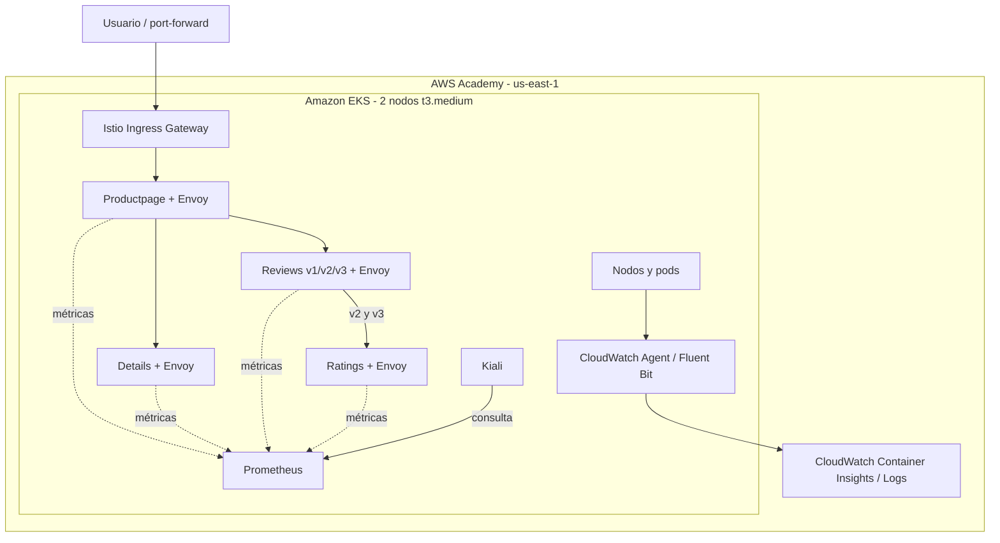

# DevOps EV3 | Microservices Observability

      

Proyecto académico de **Ingeniería DevOps — Duoc UC**. Implementación de una plataforma de observabilidad sobre Amazon EKS utilizando la aplicación Bookinfo, una malla de servicios Istio y herramientas de monitoreo de tráfico e infraestructura.

##  Objetivos

- Aprovisionar un clúster EKS reproducible, reutilizando el rol IAM del Learner Lab.
- Desplegar microservicios con inyección automática de Envoy Sidecars.
- Observar tráfico HTTP, latencia, errores, CPU, memoria y logs.
- Automatizar validaciones de calidad y controlar la limpieza de recursos cloud.

##  Arquitectura



| Microservicio | Lenguaje | Responsabilidad |
|---|---|---|
| Productpage | Python | Interfaz web y agregación de datos |
| Details | Ruby | Información de libros |
| Reviews | Java | Reseñas en tres versiones |
| Ratings | Node.js | Calificaciones |

Bookinfo utiliza imágenes públicas `1.20.3`, sin construcción local. Kiali `2.34`, Prometheus `3.10.0` y config-reloader `0.89.0` corresponden a las versiones fijadas del material suministrado. Kubernetes observado: `1.37.1`. CloudWatch utiliza un add-on compatible consultado mediante AWS CLI.

## Estructura del proyecto

```text
devops-ev3-observability/
├── .github/workflows/ci-cd.yml
├── infrastructure/eks-cluster.yaml
├── kubernetes/                 # Namespace y Bookinfo
├── istio/                      # Instalación, rutas y telemetría
├── monitoring/                 # Kiali, Prometheus y CloudWatch
├── scripts/                    # Automatización y validaciones
├── tests/                      # Pruebas del validador
├── docs/                       # Arquitectura y evidencias
├── requirements-dev.txt
└── README.md
```

##  Instalación y despliegue

**Requisitos:** Windows 11 / VS Code / Git Bash, [AWS CLI v2](https://awscli.amazonaws.com/AWSCLIV2.msi), [eksctl](https://github.com/eksctl-io/eksctl/releases/latest), [kubectl 1.37.x](https://docs.aws.amazon.com/eks/latest/userguide/install-kubectl.html), [istioctl 1.32.0](https://github.com/istio/istio/releases/tag/1.32.0), Python y Git en el PATH.

Iniciar AWS Academy Learner Lab y copiar las credenciales temporales completas (incluido el token de sesión) a `~/.aws/credentials`, fuera del repositorio. No publicar claves ni crear roles IAM nuevos.

```bash
aws configure
aws sts get-caller-identity
python -m pip install -r requirements-dev.txt
bash scripts/preflight.sh
python scripts/validate.py
bash scripts/create-cluster.sh
bash scripts/deploy.sh
```

> **Costos:** EKS y sus dos nodos EC2 consumen créditos. Revisar clústeres existentes antes de crear otro. El script reutiliza LabRole; la configuración local renderizada no debe publicarse.

**Validación del despliegue:**

```bash
kubectl --context devops-ev3 get nodes
kubectl --context devops-ev3 get pods -n microservices-demo
kubectl --context devops-ev3 get pods -n istio-system
kubectl --context devops-ev3 get svc kiali-lb -n istio-system
istioctl --context devops-ev3 proxy-status
istioctl --context devops-ev3 analyze --all-namespaces
```

En la ejecución observada, los seis pods de Bookinfo quedaron `2/2 Running`, pero la comprobación final de `deploy.sh` emitió un `AssertionError`. Se debe revisar esa comprobación sin eliminarla; no es necesario recrear el clúster para diagnosticarla. La medición de duración del script queda pendiente de una ejecución completa.

##  Interfaces y generación de tráfico

Ejecutar cada port-forward en una terminal independiente:

```bash
kubectl --context devops-ev3 -n istio-system port-forward svc/istio-ingressgateway 8080:80
kubectl --context devops-ev3 -n istio-system port-forward svc/kiali 20001:20001
kubectl --context devops-ev3 -n istio-system port-forward svc/prometheus 9090:9090
```

| Interfaz | Acceso local |
|---|---|
| Bookinfo | [localhost:8080/productpage](http://localhost:8080/productpage) |
| Kiali | [localhost:20001/kiali](http://localhost:20001/kiali) |
| Prometheus | [localhost:9090](http://localhost:9090) |

Kiali utiliza autenticación anónima del ejemplo; su LoadBalancer es interno. No exponerlo a internet sin autenticación y restricciones adecuadas.

```bash
bash scripts/generate-traffic.sh 300
bash scripts/cloudwatch.sh
kubectl --context devops-ev3 get pods -n amazon-cloudwatch
```

##  Observabilidad y resultados

| Herramienta | Visualización |
|---|---|
| Kiali | Grafo de tráfico, salud, rutas y latencia de la malla |
| Prometheus | Métricas de solicitudes HTTP, latencia y errores mediante PromQL |
| CloudWatch | CPU, memoria, red y logs de nodos y contenedores |

En Kiali seleccionar `microservices-demo`, gráfico por versiones y últimos cinco minutos. En Prometheus utilizar Graph y ejecutar, por ejemplo:

```promql
sum by (destination_app) (rate(istio_requests_total{destination_workload_namespace="microservices-demo",reporter="destination"}[5m]))
```

```promql
histogram_quantile(0.95, sum by (le, destination_app) (rate(istio_request_duration_milliseconds_bucket{destination_workload_namespace="microservices-demo",reporter="destination"}[5m])))
```

En AWS CloudWatch, abrir Container Insights, seleccionar `devops-ev3` y filtrar por `microservices-demo`. En Logs Insights seleccionar `/aws/containerinsights/devops-ev3/application`:

```sql
fields @timestamp, @message
| filter @message like /productpage/
| sort @timestamp desc
| limit 100
```

**Resultados observados durante la demostración:** dos nodos Ready, seis pods Bookinfo `2/2 Running`, cinco pods de CloudWatch operativos, solicitudes HTTP 200 y métricas visibles en Kiali y Container Insights. En una captura de Kiali se observaron 1.9 RPS entrantes y salientes y 0% de errores en los cuatro servicios.

| Servicio | Latencia observada |
|---|---:|
| Productpage | 55.66 ms |
| Reviews | 38.23 ms |
| Ratings | 4.66 ms |
| Details | 4.61 ms |

Valores correspondientes al intervalo de la captura; no constituyen una prueba de carga ni una garantía de rendimiento. Las advertencias del resumen de Kiali requieren revisión.

##  CI/CD y controles de calidad

GitHub Actions ejecuta validación de manifiestos YAML, sintaxis Bash, políticas de imágenes y roles, pruebas automatizadas y cobertura mínima del 65% del validador propio (no de Bookinfo).

```bash
python -m pip install coverage
python -m unittest discover -s tests -v
python -m coverage run -m unittest discover -s tests
python -m coverage report --fail-under=65
```

El workflow se activa con push y PR según las ramas configuradas. Configurar protección de `main` y `development` con el check `validate` obligatorio y demostrar un fallo controlado. En el repositorio público, el despliegue es local y manual; el CD del workflow solo se habilita mediante ejecución manual en `main` de un repositorio privado, tras CI exitoso, con runner Linux dedicado `ev3-trusted`, entorno `learner-lab` y credenciales fuera del repositorio. No conectar un runner persistente al repositorio público. La ejecución remota, la protección de ramas y el bloqueo ante fallos están pendientes de evidenciar.


##  Limpieza de recursos

Guardar evidencias y presupuesto antes de ejecutar:

```bash
bash scripts/cleanup.sh
aws eks list-clusters --region us-east-1
```

Verificar en AWS la eliminación de los recursos propios: EKS, EC2, balanceadores, EBS y stacks de CloudFormation. Revisar y eliminar los grupos de logs del proyecto cuando ya no sean necesarios; registrar el presupuesto final. No eliminar recursos de otros proyectos. Si el clúster no llegó a crearse, revisar específicamente los stacks fallidos.

##  Referencias y licencia

- [Istio / Bookinfo](https://istio.io/latest/docs/examples/bookinfo/) · [Kiali](https://kiali.io/) · [Prometheus](https://prometheus.io/docs/)
- [Amazon EKS](https://docs.aws.amazon.com/eks/) · [Container Insights](https://docs.aws.amazon.com/AmazonCloudWatch/latest/monitoring/ContainerInsights.html)


