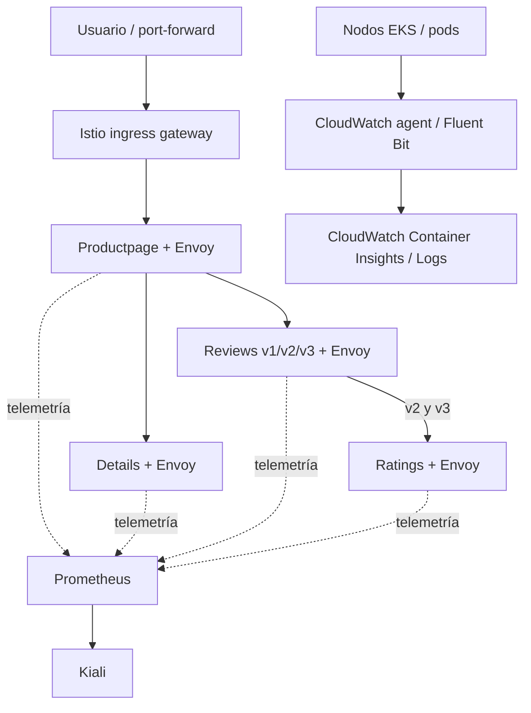

# Arquitectura propuesta

Componentes: EKS ejecuta los pods; Istio configura Envoy; Prometheus recolecta métricas de tráfico; Kiali consulta Prometheus; CloudWatch recibe métricas de infraestructura y logs. El equipo debe redactar sus propias decisiones técnicas y reflexiones tras observar los resultados.

Consultas PromQL de referencia (ejecutar tras generar tráfico):

- `sum(rate(istio_requests_total{destination_workload_namespace="microservices-demo",reporter="destination"}[5m]))`
- `sum(rate(istio_requests_total{destination_workload_namespace="microservices-demo",reporter="destination",response_code=~"5.."}[5m]))`
- `histogram_quantile(0.95,sum by(le,destination_workload)(rate(istio_request_duration_milliseconds_bucket{destination_workload_namespace="microservices-demo",reporter="destination"}[5m])))`
